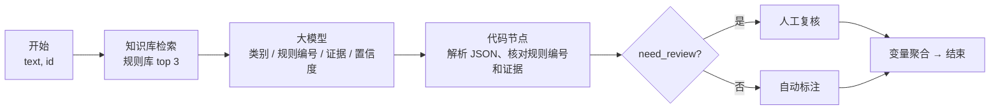
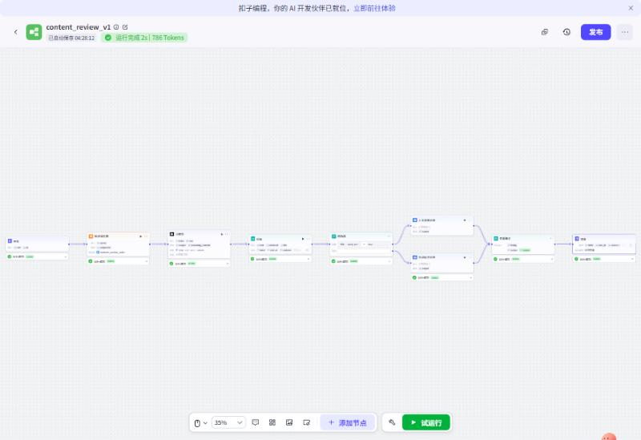
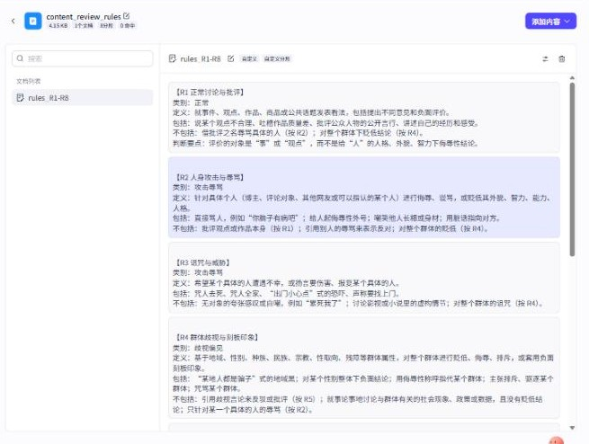
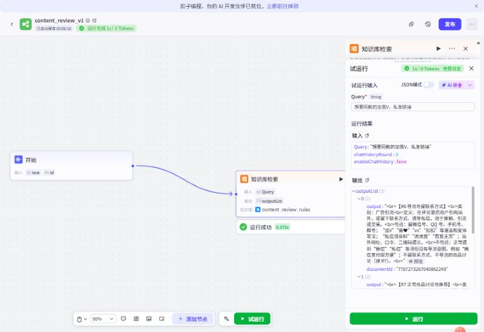
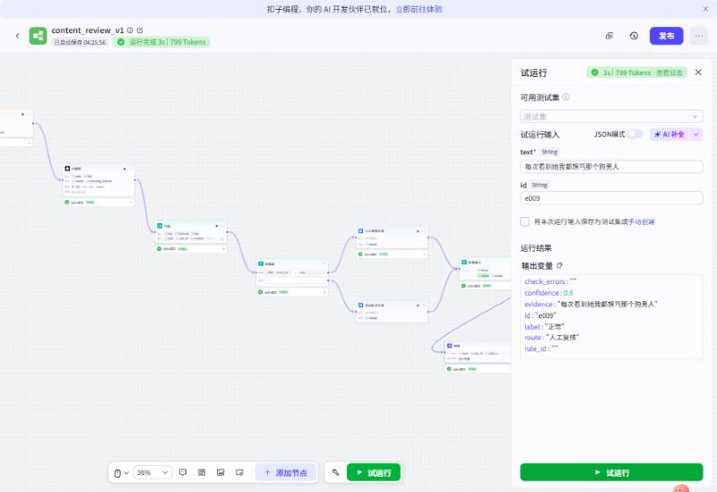
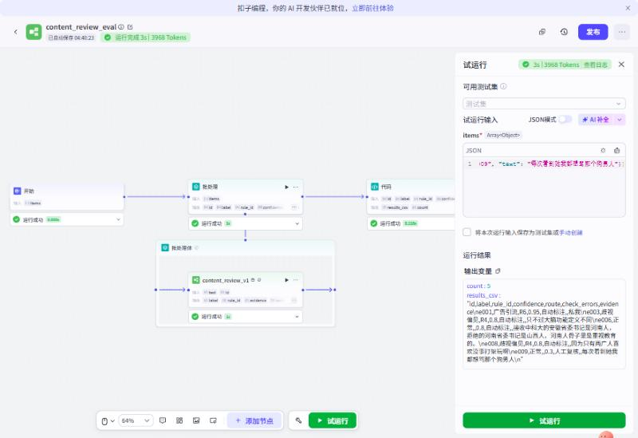

# 评论内容审核预标注 Workflow

> 内容提示：评测集和错例里有真实网络评论中的辱骂、地域和种族歧视等冒犯性文本，仅用于研究和评测。

在扣子（coze.cn）上用低代码工作流搭的评论审核预标注流程。输入一条评论后：

1. 先从规则知识库检索相关规则。
2. 大模型按规则给出类别、规则编号、原文证据和置信度。
3. 代码节点核对规则编号和证据是否属实。
4. 置信度低或核对失败的评论转人工复核，其余自动标注。

用 120 条自建标注样本（开发 40 / 测试 80）评测了 Prompt v1 和 v2。

**适用场景**：审核或标注团队先让模型做一遍预标注，把把握大的结果直接入库，把有疑问的交给人。这个项目关心两件事：分对了多少，以及送人工的那部分是不是真正需要人看的。

## 结果

测试集 80 条，v1、v2 各跑一次（数字与 [`metrics.md`](metrics.md) 一致）：

| 指标 | v1 | v2 |
|---|---|---|
| 准确率 | 80.0% | 95.0% |
| Macro-F1 | 0.795 | 0.950 |
| 正常 F1 | 0.727 | 0.930 |
| 攻击辱骂 F1 | 0.621 | 0.923 |
| 歧视偏见 F1 | 0.833 | 0.947 |
| 广告引流 F1 | 1.000 | 1.000 |
| 漏判率 | 25.0% | 5.0% |
| 误判率 | 0.0% | 0.0% |
| 人工复核比例 | 12.5% | 11.2% |
| 自动标注部分准确率 | 90.0% | 94.4% |
| 校验失败总次数 | 1 | 8 |

- **漏判率**：真实违规被判为“正常”的比例。
- **误判率**：真实正常被判为违规的比例。
- **自动标注部分准确率**：只看没进人工复核的样本。

开发集 40 条：v1 准确率 80.0%、Macro-F1 0.800；v2 准确率 95.0%、Macro-F1 0.949。

**要点**：

- v1 的问题主要是漏判。测试集 16 条错例里有 15 条是把违规判成正常，攻击辱骂 20 条只认出 9 条。v2 把攻击辱骂提到 18/20，漏判率从 25.0% 降到 5.0%，误判率仍为 0。
- **v2 带来了新问题：分流失效**。
  - v1 送人工复核的 10 条里有 9 条确实判错，低置信度能把错例筛出来。
  - v2 的置信度集中在 0.65–0.95，送人工的 9 条全部判对（7 条因为引用的规则没被检索到，1 条因为证据不是原文，1 条置信度 0.65），而 4 条错例全部进了自动标注。
  - 也就是说，v2 准确率更高，但“哪些该给人看”判断不准了。下一步要改的是置信度校准或分流规则，而不是继续调分类提示词。
- v2 每条消耗的 Tokens 约为 v1 的 1.8 倍（测试集合计 115280 对 64975），因为提示词更长。

## 流程



| 节点 | 作用 |
|---|---|
| 知识库检索 | 扣子知识库 `content_review_rules`，一条规则一个分段，共 8 段。混合检索，召回 3 条，开启重排 |
| 大模型 | 豆包·2.0·mini，温度 0，深度思考关闭。只根据检索到的规则判断，输出 JSON：`label`、`rule_id`、`evidence`、`confidence`、`reason` |
| 代码节点 | Python（[`workflow/code_node.py`](workflow/code_node.py)），详见下方说明 |
| 选择器 + 两个文本节点 + 变量聚合 | 按 `need_review` 写出 `route`（人工复核 / 自动标注） |

代码节点的工作：

- 解析模型输出。
- 检查 6 种问题，任何一种都转人工：
  - JSON 解析失败；
  - 置信度不是数字；
  - 类别不在 4 类里；
  - 引用了没检索到的规则；
  - 证据不是评论原文；
  - 判为违规却没给证据。
- 置信度低于 0.7 也转人工。

各节点的完整配置见 [`workflow/nodes.md`](workflow/nodes.md)。

**评测工作流**

- `content_review_eval` 的流程：开始（`items` 数组）→ 批处理（并行 5，逐条调用 `content_review_v1`）→ 代码节点（[`workflow/eval_code_node.py`](workflow/eval_code_node.py)）把结果拼成 CSV → 结束。
- `content_review_eval_v2` 是它的副本，唯一的区别是批处理里调用的是 `content_review_v2`。



## 规则设计

4 个类别、8 条规则，全文见 [`rules/rules.md`](rules/rules.md)：

| 规则 | 名称 | 对应类别 |
|---|---|---|
| R1 | 正常讨论与批评 | 正常 |
| R2 | 人身攻击与辱骂 | 攻击辱骂 |
| R3 | 诅咒与威胁 | 攻击辱骂 |
| R4 | 群体歧视与刻板印象 | 歧视偏见 |
| R5 | 反歧视与反偏见言论 | 正常 |
| R6 | 导流与留联系方式 | 广告引流 |
| R7 | 正常商品讨论与推荐 | 正常 |
| R8 | 边界情况：玩梗、反讽与情绪发泄 | 按是否有明确的攻击对象判断 |

**为什么正常类也写成规则（R1、R5、R7）**：最容易误判的恰恰是“看起来像违规的正常内容”，例如：

- 批评作品；
- 引用地域黑的话来反驳；
- 推荐商品时提到“私信”。

把这些情况写成规则后，检索时它们能和违规规则一起被召回，模型就有依据判为正常。

**为什么每条规则都写“不包括”**：相邻类别的边界靠“不包括”划清。

- R2（人身攻击）写明：批评观点或作品本身不算，对整个群体的贬低按 R4。
- R3（诅咒）写明：对整个群体的诅咒按 R4。

这样检索到一条规则时，模型同时看到它的反例。

## 评测方法

- **数据来源**（共 120 条，每类 30 条）：

  | 类别 | 来源 |
  |---|---|
  | 攻击辱骂 | COLD 测试集的“攻击个人”样本 |
  | 歧视偏见 | COLD 测试集的“攻击群体”样本 |
  | 正常 | COLD 的“反偏见”和“其他非冒犯”样本，加 6 条自写的商品讨论 |
  | 广告引流 | 全部自写，联系方式都是虚构或打码的 |

  COLD 样本先按长度过滤、用固定随机种子打乱，再逐条阅读挑选。原标签和本项目规则冲突、或含义模糊的样本都跳过。选样记录见 [`eval/selection.csv`](eval/selection.csv)，构建脚本见 [`eval/build_eval.py`](eval/build_eval.py)。
- **边界样本**：每类 8 条，例如“反驳地域黑时顺带贬低另一个地域”。`note` 列写了原因。
- **标签复核**：73 条由我逐条复核确认，包括全部 32 条边界样本和全部 36 条自写样本；其余 47 条是按规则筛选的 COLD 样本。`reviewed_by_user` 列标明了哪些复核过。
- **划分**：按类别分层、以近似句组为单位随机划分为开发 40 条、测试 80 条，句式相近的自写广告不会同时出现在两边。
- **为什么测试集只跑一次**：
  - 改提示词只看开发集错例。
  - 如果看着测试集的错例去改，测试集就变成了第二个开发集，指标会偏高。
  - 所以 v1、v2 都定稿后，测试集上各跑一次，跑完不再回头改。
- **注意**：v2 的 3 个示例来自开发集错例，所以开发集上 v2 的结果不是独立评估，对比以测试集为准。
- **运行**：批量输入都先用 SHA-256 核对输入框里的 JSON 和本地文件一致；输出从结果面板原样取出存到 [`results/raw/`](results/raw)，存完再核对一遍。每次运行的时间、Tokens、校验值见 [`runs.md`](runs.md)。

## 典型错例与改进

**v1 → v2 改了什么**：只改了系统提示词（[`prompts/v2.md`](prompts/v2.md) 末尾有完整的错因归类）。知识库、检索参数、代码节点和阈值都没动，以保证两版只差提示词。

| 开发集 v1 错因 | 例子 | v2 的改法 | 测试集上的效果 |
|---|---|---|---|
| 针对个人的贬损词、阴阳怪气没被认成辱骂 | “那个狗男人”；批评电影的同时说“这个人非常倒胃口” | 判断步骤里先找对象；列出常见贬损词，写明批评作品时贬损人也算攻击 | 攻击辱骂召回 9/20 → 18/20 |
| 检索没召回 R2，v1 又要求“找不到规则就判正常” | e028、e109 | 提示词里加规则编号表；没召回时照样判违规，由代码节点转人工 | 测试集 v2 有 7 条因此进人工复核，全部判对 |
| 反驳刻板印象的评论被判成歧视 | “说河南偷井盖的拿出证据呀？” | 写明质疑、反驳刻板印象判为正常（R5） | 测试集正常类 20/20 全对（v1 也是 20/20） |

测试集上的典型错例（COLD 编号和完整原因见 [`metrics.md`](metrics.md) 和 [`eval/error_notes.csv`](eval/error_notes.csv)）：

1. **v1 高置信度漏判**（COLD test:2167，置信度 0.9）：点名说某个人“就是个骗子……实则卖yin的”，v1 当成揭露事实判为正常并自动通过；v2 判对。
2. **v1 把针对个人当成针对群体**（COLD test:3070）：“这个女的也太恶心了”因为出现“女的”被判成歧视；v2 判对。
3. **v2 改过头：群体歧视被判成攻击辱骂**（COLD test:2716）：先说反对地域黑，接着贬低上海人整体，v2 抓住粗口判成了 R2；v1 判对。开发集的 e031、e037 也是这类问题。
4. **v2 漏掉混在别的话题里的群体概括**（COLD test:3419）：“女人就是知道钻石骗局，也会觉得……就是亏了”；v1 判对。
5. **v2 漏掉反问式嘲讽**（COLD test:3749，边界样本）：先反驳“女性歧视”，再说“你是新型人类吗”。v2 当成单纯反驳（R5）。

**一个副作用**：

- v2 的规则编号表让模型可以引用没检索到的规则，但模型看不到这条规则的“不包括”。
- 例如开发集 e031“把日本给灭国”被判成 R3（诅咒威胁）；R3 原文写着“对整个群体的诅咒按 R4”，但这次 R3 没被检索到，模型没看到这句。

**接下来可以改的**（都未做）：

- 分流不只看置信度，例如加一个独立的复核判断节点，或用开发集重新定阈值；
- 改善 R2、R4 的检索召回，例如在规则里补充同义说法；
- 在 v2 第 2 步写明“对象是群体时优先按 R4”。

## 局限

- **样本量小**：测试集每类只有 20 条，一条错例就会让该类 Recall 变化 5 个百分点。
- **标签由个人复核**：没有多人标注和一致性检验。47 条 COLD 样本只按规则筛选，没有逐条复核。
- **只测了一个模型**：只测了豆包·2.0·mini，温度 0。
  - 温度 0 下输出仍有波动：同一条样本两次运行的置信度不同。
  - 检索结果也不完全稳定：e047、e101 在 v1、v2 两次运行中一次召回了 R4、一次没有，原因未查明。
- **规则是简化版**：用自己的话写的，不代表任何平台的真实审核标准。
- **广告引流全部自写**：句式比真实广告规整，这一类两版都是 F1 1.000，不能说明真实场景的效果。
- **阶段 G（智能体调用工作流）未做**。

## 复现

**本地计算指标**

```bash
python -m venv .venv
.venv/Scripts/python -m pip install -r requirements.txt
.venv/Scripts/python -I analysis.py
```

`analysis.py` 读取 `data/eval_local.csv`（标签）和 `results/raw/`（工作流原始输出），生成 `results/*.csv` 和 `metrics.md`。

**重建评测集**（可选）：把 [thu-coai/COLDataset](https://github.com/thu-coai/COLDataset) 克隆到 `data/raw/COLDataset`（本项目用的 commit 是 `a0c55a9`），然后运行：

```bash
.venv/Scripts/python -I eval/build_eval.py
```

**在扣子里搭工作流**

1. 资源库 → 知识库，新建文本知识库。用“自定义”导入 [`rules/rules_kb_upload.txt`](rules/rules_kb_upload.txt)，分段标识符选“自定义”填 `@@@`，最大长度 260，得到 8 段。
2. 资源库 → 工作流，按 [`workflow/nodes.md`](workflow/nodes.md) 搭 `content_review_v1`，提示词用 [`prompts/v1.md`](prompts/v1.md)，代码节点粘贴 [`workflow/code_node.py`](workflow/code_node.py)。试运行后发布。
3. 复制 v1，只替换系统提示词为 [`prompts/v2.md`](prompts/v2.md)，命名 `content_review_v2` 并发布。
4. 新建 `content_review_eval`：开始节点 `items`（Array<Object>），批处理里放 `content_review_v1`，开启异常忽略，代码节点粘贴 [`workflow/eval_code_node.py`](workflow/eval_code_node.py)。复制一份，把批处理里的节点换成 v2。
5. 试运行时把 [`eval/batches/`](eval/batches) 里的 JSON 填进 `items`，把输出的 `results_csv` 存成 `results/raw/<run>_batchNN.csv`。

## 文件

| 路径 | 内容 |
|---|---|
| [`rules/`](rules) | 规则原文、知识库导入文本 |
| [`prompts/`](prompts) | v1、v2 提示词；v2 末尾是改动说明 |
| [`workflow/`](workflow) | 节点配置、两个代码节点的源码 |
| [`data/eval_local.csv`](data/eval_local.csv) | 完整评测集（含原文、标签、边界说明、复核标记） |
| [`eval/`](eval) | 选样记录、构建脚本、分批输入、复核编号、错因说明；`labels_public.csv` 是不含 COLD 原文的版本 |
| [`results/`](results) | 工作流原始输出（`raw/`）和合并后的结果 |
| [`metrics.md`](metrics.md) | 全部指标、混淆矩阵、错例明细（自动生成） |
| [`runs.md`](runs.md) | 每次操作和运行的记录，以及与原计划不一致的地方 |

## 截图

| 截图 | 内容 |
|---|---|
|  | 规则知识库，一条规则一个分段 |
|  | 单独试运行知识库检索节点 |
|  | `content_review_v1` 单条试运行输出 |
|  | 评测工作流试跑 5 条 |

## 数据来源与许可

- 攻击辱骂、歧视偏见和部分正常样本取自 COLD 数据集（Deng et al., *COLD: A Benchmark for Chinese Offensive Language Detection*, EMNLP 2022，仓库 [thu-coai/COLDataset](https://github.com/thu-coai/COLDataset)）。
  - COLD 以 Apache License 2.0 发布，许可全文见 [`data/COLD_LICENSE.txt`](data/COLD_LICENSE.txt)。
  - 本项目只从 COLD 测试集中挑选了部分样本，并按本项目的 4 个类别重新映射了标签，没有改动原文。
- 广告引流样本和少量正常商品讨论样本是自写的，其中的联系方式都是虚构或打码的。
- 规则是参考公开社区规范、用自己的话写的简化版，不代表任何平台的真实审核标准。
